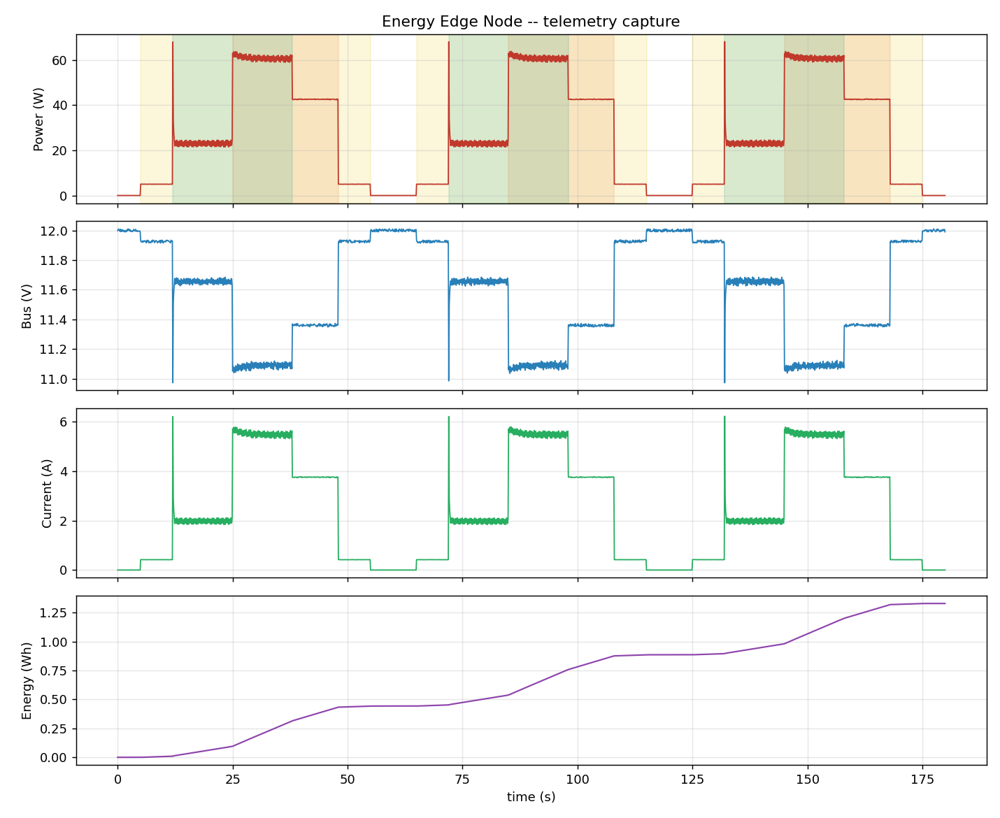

# Intelligent Energy Edge Node

An EcoStruxure-style energy node: it senses DC power, exposes the readings over
**Modbus-RTU/RS-485**, gateways them to **MQTT**, and autonomously **sheds
non-critical load** to cut peak demand and cost.

Built entirely on a **safe low-voltage DC testbed (≤24 V)** — deliberately not
mains. Same protocols, same control problem, no mains risk.

> **Status: Phase 2 complete.** Sensing, telemetry, a Modbus-RTU slave/master
> pair, an MQTT uplink with store-and-forward buffering, and a live web
> dashboard — verified by 34 host unit tests. Runs today against a built-in
> appliance simulator and a virtual RS-485 bus; swaps to real hardware by
> changing the build environment.

New here? Start with **[docs/ARCHITECTURE.md](docs/ARCHITECTURE.md)** — it
explains the whole system in plain language, no background assumed.

---

## Architecture

```
[DC loads] -> [INA226 sense] -> (telemetry ring buffer) -> Modbus-RTU slave (RS-485)
                                       |                            |
                                 [future: NILM]           Modbus master + gateway (ESP32)
                                                                    |
                                     +------------------------------+------------------+
                                     |                              |                  |
                            demand-response                MQTT -> dashboard     cost / CO2
                            controller -> relays            (live charts)
```

Everything downstream reads from **one telemetry ring buffer**. The sampler is
the only producer; the logger, Modbus slave, MQTT publisher, control loop and
(Phase 5) the NILM classifier are independent consumers with their own cursors.
A consumer that stalls cannot stall the sampler or any other consumer — it just
takes an overrun, which is counted rather than hidden.

The same buffer runs at both tiers: on the meter it holds sampling history, and
on the gateway it *is* the store-and-forward buffer that survives an MQTT
outage.

---

## Repo layout

```
meter_node/        ESP32 — INA226 sampling, energy accumulation, Modbus-RTU slave
gateway_node/      ESP32 — Modbus master, MQTT uplink, store-and-forward
common/telemetry/  shared sample format, ring buffer, store-and-forward
common/modbus/     shared protocol — framing, register map, RS-485 transport
dashboard/         web — live MQTT charts, broker config
tools/             replay.py, mock_publisher.py, check_device_model.py
docs/              architecture, register map, device model, captures, plots
```

Everything under `common/` is compiled into **both** firmwares. The register map
has exactly one definition, so the two ends of the bus cannot drift apart — and
the gateway's store-and-forward buffer is literally the same, already tested,
ring buffer the meter samples into.

---

## Build targets

The meter node has four PlatformIO environments:

| Environment    | Runs on | Purpose |
|----------------|---------|---------|
| `esp32dev-sim` | ESP32   | Simulated appliances — **no sensor needed** (default) |
| `esp32dev`     | ESP32   | Real INA226 over I2C |
| `native-sim`   | PC      | Whole pipeline on the host, emits a capture to stdout |
| `native`       | PC      | Unit tests — ring buffer, Modbus, store-and-forward |

The gateway node has one environment, `esp32dev`.

The only difference between the two ESP32 builds is `-D USE_INA226_SIM`. Both
link the identical telemetry, energy and ring-buffer code.

### Run it

```bash
# unit tests — no hardware (34 tests)
pio test -e native -d meter_node

# verify the register map's three copies still agree
python tools/check_device_model.py

# generate a 180 s capture on your PC
pio run -e native-sim -d meter_node
./meter_node/.pio/build/native-sim/program 180 > docs/captures/sim_180s.csv

# summarise and plot it
python tools/replay.py docs/captures/sim_180s.csv

# flash the meter (simulated loads) and watch the stream
pio run -e esp32dev-sim -d meter_node -t upload
pio device monitor -e esp32dev-sim

# flash the gateway; it scans the bus, polls, and publishes to MQTT
cp gateway_node/include/secrets.example.h gateway_node/include/secrets.h  # then edit
pio run -e esp32dev -d gateway_node -t upload
pio device monitor -e esp32dev -d gateway_node
```

See the dashboard with no broker and no hardware: open `dashboard/index.html`,
click **Replay a capture**, pick `docs/captures/sim_180s.csv`.

---

## The appliance simulator

Three loads on a 12 V bus, each with a deliberately distinct signature:

| Load   | Steady | Signature |
|--------|--------|-----------|
| lights | 5 W    | clean step, no transient |
| heater | 40 W   | step, then ~6% droop as the element warms and its resistance rises |
| motor  | 18 W   | ~3.5× inrush decaying over ~250 ms, then 7 Hz commutation ripple |

The bus sags under load (`V = 12.0 − 0.18·I`), and a seeded PRNG makes every run
byte-identical.

This is not a placeholder for missing hardware — it is also the **Phase 5
training rig**. Every sample carries a `truth` bitmask of which loads were
really on, which is exactly the vector a NILM classifier outputs. The classifier
can be scored against known ground truth before it ever meets a real appliance.

---

## Telemetry log format

Data rows are prefixed `T,` so a capture survives being mixed with boot chatter
and `#` notes on the same serial line.

```
# energy-edge-node telemetry v1
# source=sim sensor_init=ok rate_hz=10 ring=256
# fields: seq,t_ms,v_v,i_a,p_w,wh,flags,truth
T,0,0,11.999,0.0000,0.000,0.000000,128,0
```

| Field   | Meaning |
|---------|---------|
| `seq`   | monotonic sample number — a gap proves dropped samples |
| `t_ms`  | ms since boot |
| `v,i,p` | bus volts, amps, watts (power from the INA226's own register, not V×I) |
| `wh`    | cumulative energy, trapezoidal over real elapsed time |
| `flags` | `0x01` sensor fail · `0x02` over-power · `0x04` backfilled · `0x80` simulated |
| `truth` | `0x01` lights · `0x02` heater · `0x04` motor (simulator ground truth) |

---

## MQTT, store-and-forward and the dashboard (Phase 2)

The gateway publishes every poll to an MQTT broker; a web page charts it live.
Setup and the topic list: **[dashboard/README.md](dashboard/README.md)**.

### Store-and-forward — the feature worth demoing

WiFi drops. A naive publisher throws away every reading taken while the link was
down, leaving holes in the energy record precisely when something interesting
may have happened.

Instead, readings accumulate in the ring buffer whether or not the link is up.
The forwarder is just a reader that **refuses to advance its cursor while
disconnected**; when the link returns it drains the backlog oldest-first, and
the missing history arrives late rather than never. This is how an industrial
gateway behaves — Schneider's Panel Server uses its logging memory as exactly
this kind of buffer.

```bash
python tools/mock_publisher.py docs/captures/sim_180s.csv --outage 20:25
```

Twenty seconds in, the uplink drops for twenty-five. On the dashboard: the power
chart stops, a gap opens — and when the link returns **the gap fills in**, drawn
in amber. The chart is plotted against each sample's own timestamp rather than
its arrival time, which is what lets history appear retroactively.

No ESP32 and no sensor needed for that demo. Just a broker.

### What it does not pretend to do

The ring is finite — 512 samples, ~51 s at 10 Hz. A longer outage is **real**
data loss, and the forwarder reports exactly how many readings went missing
rather than papering over the gap.
`test_outage_beyond_buffer_reports_exact_loss` asserts that published + dropped
accounts for every sample the ring ever saw.

### Also in Phase 2

- **Real clock time (SNTP, UTC).** Timestamps were milliseconds-since-boot,
  which is unusable for billing and leaves the Phase 3 tariff windows with no
  way to know when peak hours are. The gateway takes one SNTP reading and then
  tracks `base + millis()` delta rather than calling `time()` per sample —
  `time()` has 1-second resolution and can step backwards when SNTP corrects it,
  and a log whose time goes backwards is very hard to reason about.
- **Last Will and Testament.** If the gateway vanishes without saying goodbye,
  the broker publishes `offline` for it. Without this a dead gateway looks
  identical to an idle one, and the dashboard would keep showing the last
  reading as though it were current.
- **Retained status and stats topics**, so a dashboard opened later immediately
  learns what exists and how healthy it is.
- **Credentials in a gitignored `secrets.h`**, with a committed
  `secrets.example.h`. The firmware still builds without it — it just stays
  offline — so the repo is clonable by anyone.
- **Two decoupled tasks.** `poll` (prio 4, core 1) runs at a fixed 10 Hz and
  never waits on the network; `uplink` (prio 3, core 0) handles WiFi, SNTP and
  MQTT. WiFi stalls, DNS blocks, brokers go away — none of it is allowed to
  disturb metering. Store-and-forward falls out of that split rather than being
  bolted on.

### Tested without WiFi, a broker, or a board

10 of the 34 tests cover the forwarder, because the logic is "a reader that
refuses to advance while the link is down" — drivable entirely by toggling a
boolean:

| Test | Why it exists |
|---|---|
| `link_starts_down` | A forwarder that assumed the link was up would publish into a void and lose the first samples |
| `outage_buffers_instead_of_discarding` | The core claim: nothing published, nothing lost |
| `reconnect_backfills_in_order` | Backlog drains oldest-first and respects the rate budget |
| `outage_beyond_buffer_reports_exact_loss` | published + dropped must equal everything produced |
| `after_loss_survivors_are_the_newest_window` | Backfilling stale data while discarding recent data would be worse than dropping cleanly |
| `small_backlog_is_not_called_backfill` | Normal scheduling jitter must not be reported as an outage |

---

## Modbus-RTU (Phase 1)

The meter is a **Modbus-RTU slave**; the gateway is a **Modbus-RTU master**.
Full register map: **[docs/MODBUS_REGISTERS.md](docs/MODBUS_REGISTERS.md)**.
Machine-readable: **[docs/device_model.json](docs/device_model.json)**.

| | |
|---|---|
| Physical layer | RS-485 half duplex, 19200 8N1 |
| Function codes | `0x03`, `0x04` read · `0x06`, `0x10` write |
| Poll | one FC4 transaction, 39 registers, 10 Hz |
| Float encoding | float32, **high word first** (PowerLogic convention) |
| Addressing | protocol (0-based) |

### Tested without any RS-485 hardware

The protocol code knows nothing about UARTs — you hand it a frame and a reply
buffer. So a master and a slave can talk **through memory**, and the whole
request/response cycle is verified on a PC: CRC, framing, float word order,
block reads, exceptions, broadcast suppression, and the retry path.

18 of the 34 unit tests cover Modbus. The ones worth knowing about:

| Test | Why it exists |
|---|---|
| `float_word_order_is_high_word_first` | Swapped words is *the* classic Modbus bug — every float becomes a wild magnitude. Known-answer test: `1.0f` must encode as `0x3F80,0x0000`. |
| `crc_of_frame_including_crc_is_zero` | Verifies the CRC algorithm *and* its byte order in one assertion. |
| `bad_crc_is_silently_dropped` | A corrupt frame must get **no reply**. Answering line noise turns it into bus traffic. |
| `broadcast_write_applies_but_is_not_answered` | Unit 0 must act without replying, or several slaves collide on a half-duplex line. |
| `write_to_measurement_register_is_rejected` | A master must not be able to overwrite a measurement and read back its own lie. |
| `scaled_block_clamps_garbage` | A NaN or a sensor fault must saturate, not wrap into a plausible wrong number. |

### Things the firmware does that are easy to get wrong

- **DE is dropped only after `flush()`.** The UART must finish shifting out the
  last stop bit before the transceiver stops driving, or the end of every frame
  is truncated and shows up as a CRC error at the far end.
- **Framing is a timer, not a parser.** Modbus-RTU has no end byte; a frame ends
  after 3.5 character times of silence (~2 ms at 19200).
- **The input buffer is flushed before each request.** Otherwise a late reply to
  the *previous* question gets parsed as the answer to this one — which yields
  plausible but wrong data, the worst failure mode available.
- **The slave answers with its own cursor on the ring**, fast-forwarding to the
  newest sample. Registers hold present values, not history — while the logger,
  reading the same ring, keeps every sample. Two readers, two needs, neither
  aware of the other.
- **`sample_seq` is published** so a master can tell "steady load" from "the
  meter has silently stopped sampling". Reading power alone cannot distinguish
  those two, because they look identical.

### Discovery instead of hard-coding

The gateway sweeps unit IDs 1–16 at startup and asks each one "who are you?".
Whoever answers with the right vendor ID is added to the poll list. Adding a
second meter is a DIP-switch change, not a code change — which is how real
commissioning tools behave.

It also reads the `SIMULATED` capability bit, so the gateway knows whether it is
looking at real measurements or synthetic ones. Data that silently claims to be
real when it is not is worse than no data.

---

## Phase 0 results

180 s host capture (`docs/captures/sim_180s.csv`):

```
samples      1800        dropped      0
rate         10.01 Hz    sensor fail  0
voltage      10.97 .. 12.01 V
power        0.00 .. 68.17 W  (mean 26.57)
energy       1.3284 Wh
peak/mean    2.57x   <-- Phase 3 target
```



That **2.57× peak-to-mean ratio is the "before" number.** Phase 3's job is to
shrink it by shedding the heater when the motor and lights are already running.

Firmware footprint:

| Node | RAM | Flash |
|---|---|---|
| meter (simulated) | 9.5% (31.1 kB) | 24.3% (318 kB) |
| gateway (Modbus + MQTT) | 22.3% (72.9 kB) | 33.4% (438 kB) |

The gateway's larger RAM figure is two 512-sample rings (~41 kB) plus the WiFi
and MQTT stacks. The arithmetic behind that trade-off is in
`gateway_node/include/config.h`.

---

## Roadmap

- [x] **Phase 0** — INA226 sampling, telemetry ring buffer, energy accumulation, replayable logs
- [x] **Phase 1** — Modbus-RTU slave + master over RS-485, register map, device model, bus discovery
- [x] **Phase 2** — MQTT uplink, live dashboard, **store-and-forward** buffering, SNTP clock, LWT
- [ ] **Phase 3** — demand response: **rolling demand window**, tariff schedule, hysteresis, load priority, alarms
- [ ] **Phase 3.5** — Modbus-TCP gateway (transparent RTU↔TCP routing by unit ID)
- [ ] **Phase 4** — full FreeRTOS task split, MQTT over TLS, security notes against **IEC 62443**
- [ ] **Phase 5** — NILM appliance disaggregation from the aggregate signal

Phases 3–5 incorporate features drawn from Schneider's EcoStruxure
architecture — rolling demand windows, device models, Modbus-TCP gateways,
IEC 62443 hardening. See
[docs/ARCHITECTURE.md](docs/ARCHITECTURE.md#7-what-comes-next) for what each one
maps to and why.

---

## Limitations & future work

- Low-voltage DC testbed only; no mains metering, and no AC concerns (power
  factor, harmonics, true RMS) are modelled.
- **The INA226 driver and the RS-485 transport are written from the datasheets
  and have never run on real silicon.** The protocol logic above them is tested;
  the two layers that touch hardware are not, and will need bring-up when the
  parts arrive. See the checklist at the end of
  [docs/MODBUS_REGISTERS.md](docs/MODBUS_REGISTERS.md).
- **The MQTT and SNTP paths are compile-verified and their buffering logic is
  unit-tested, but they have not run against a live broker yet.**
- **MQTT has no authentication or TLS.** The bench broker runs
  `allow_anonymous true`, which is fine on a laptop behind a home router and
  unacceptable on anything exposed. Phase 4 adds TLS, credentials and per-topic
  access control.
- Readings come from the simulator unless built with `esp32dev`; accuracy
  against a reference multimeter is still to be measured.
- Energy is integrated from the boot instant and is not persisted across resets.
- The meter node has no clock of its own; wall-clock timestamps are applied by
  the gateway at poll time.
- The dashboard holds ~4 minutes in memory. There is no historical store.
- Cost and CO2 use flat assumed rates — ₹8/kWh and 710 gCO2/kWh. Both are
  assumptions, not measurements. Time-of-use pricing arrives with the Phase 3
  controller; set them to your own tariff before quoting any figure.

Next after the roadmap: Modbus-TCP and BACnet, OT-security hardening.
